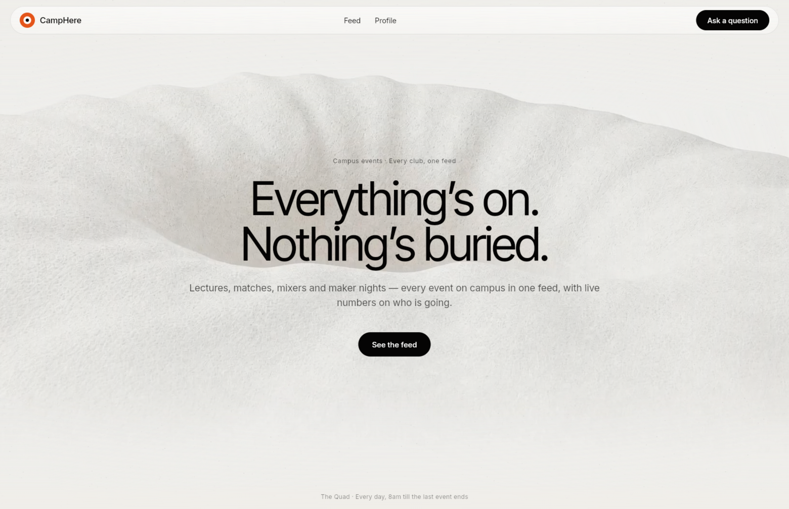
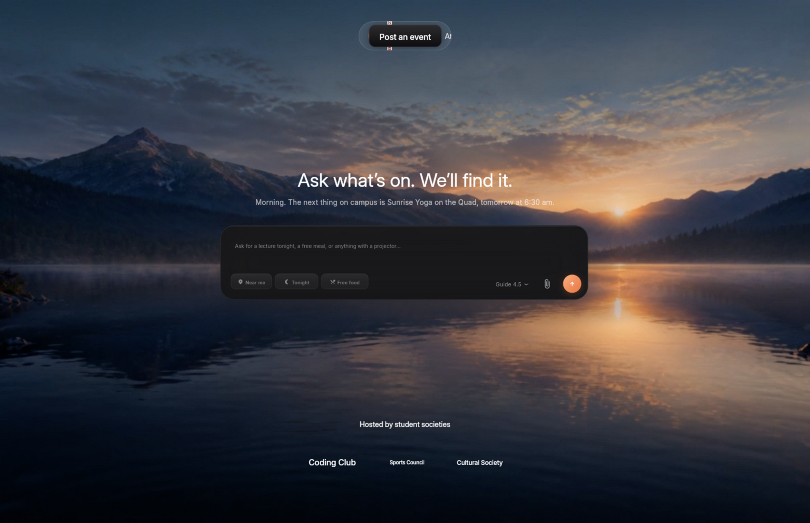
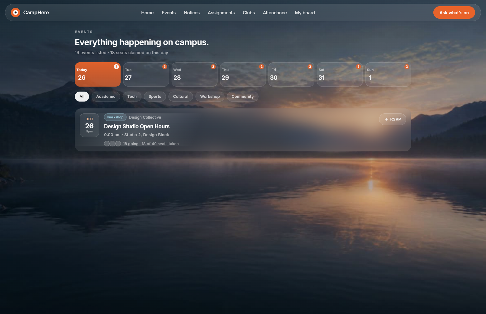
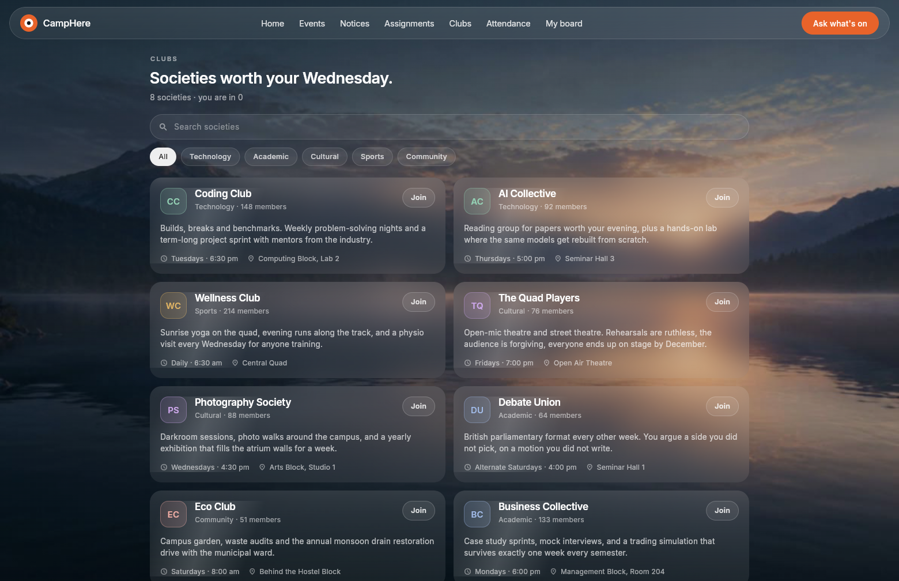

# CampHere

**Every corner of campus, in one quiet app.**

CampHere is a campus companion built by Team Pseudo College's (IILM Grid
Noida). It puts the events desk, the notice board, the assignment list, the
societies directory, attendance and your own RSVP board behind one
liquid-glass interface — and an ask-anything guide that searches all of it, so
students stop reconstructing their campus from WhatsApp groups and corridor
boards.

[](https://github.com/kunalbuilds-git/campus-app/actions/workflows/ci.yml)
[](https://github.com/kunalbuilds-git/campus-app/actions/workflows/security.yml)

<p align="center">
  <video src="https://raw.githubusercontent.com/kunalbuilds-git/campus-app/main/docs/demo/demo.mp4"
         controls muted playsinline width="720"></video>
</p>

*Walkthrough of the original five surfaces: home → the guide answering "what
is on tonight?" → notice board → attendance → my board. Recorded from the
running build.*

## What's inside

<p align="center">
  
  
</p>
<p align="center">
  
  
</p>
<p align="center">
  
  
</p>

| Surface | Route | What it does |
|---|---|---|
| **Home** | `/` | An editorial front door where scrolling scrubs a 3D-render film frame by frame while three copy panels cross-fade. Nothing on the page actually scrolls. |
| **Events** | `/events` | The events desk, laid out like a ticketing site: a seven-day strip with a count on every day, a category filter, and a seat button per event. RSVP goes to the backend when it is reachable and is kept on the device when it is not. |
| **Guide** | `/chat` | An intra-app assistant that searches the whole app — tonight's events, free food, fixtures, societies, seats left, your board — and answers with real event cards. Backed by a multi-provider LLM chain (Groq → OpenRouter → NVIDIA NIM) that fails over silently, with an offline search that always works. |
| **Notice board** | `/notices` | Everything offices and societies publish, pinned first, filterable by category. Any notice can be **shared AirDrop-style**: a QR + six-character code the next student types or scans. |
| **Assignments** | `/assignments` | What is owed and by when, grouped into overdue, due today, this week and submitted. Each row is a checkbox, so handing something in is one tap. |
| **Clubs** | `/clubs` | The societies directory, searchable and filterable by kind, with the member count and the join control on every card. |
| **Attendance** | `/attendance` | The term at a glance — overall percentage, per-subject bars with a "short by N classes to reach 75%" calculation, and the week's trend. The counts are the student's own, so **tap a subject to correct them**. |
| **My board** | `/profile` | Your RSVPs, societies and the week — plus a **For you** card ranked by an on-device behavioural model (what you actually open, not what everyone opens). |

The app runs on web today and ships to Android from the same codebase
(the `android/` platform is set up; a debug-signed release APK builds with
one command).

## Setup

### Prerequisites

- **Flutter 3.44+** with Dart 3.12+ (`flutter --version` to check; the
  project pins its minimums in `campus_quiz/campus_quiz_flutter/pubspec.yaml`)
- **Serverpod CLI 4.x**, matching the server's version:
  ```bash
  dart pub global activate serverpod_cli 4.0.4
  ```
  Make sure `~/.pub-cache/bin` is on your PATH.
- For running the backend locally: **Docker** (for PostgreSQL and Redis), or
  skip the backend entirely — the app runs fine on bundled sample data.

### 1. Get the code

```bash
git clone https://github.com/kunalbuilds-git/campus-app.git
cd campus-app/campus_quiz
dart pub get          # resolves the whole Dart workspace at once
```

### 2. Run the app (no backend needed)

```bash
cd campus_quiz_flutter
flutter run -d chrome          # or: -d web-server --web-port 8085
```

Every surface falls back to bundled sample data in
`lib/data/campus_seed.dart`, so the whole product works offline. This is how
we demo it.

### 3. Run the backend (live data)

```bash
cd campus_quiz_server
serverpod start --no-flutter   # starts the API on :8080 (and its database)
```

First run needs a database password file — create
`campus_quiz_server/config/passwords.yaml` (it is gitignored, never commit it):

```yaml
database: '<a random string>'
redis: '<a random string>'
serviceSecret: '<a random string>'
emailSecretHashPepper: '<a random string>'
```

On boot in development mode the server seeds sample events and notices.
The Flutter app picks its API address from
`campus_quiz_flutter/assets/config.json` (`http://localhost:8080` by
default; point it at your LAN IP to test from a phone).

### 4. Enable the LLM guide (optional)

The guide works without any keys — it falls back to the built-in search.
To let a real LLM write the prose, pass keys at build time (never commit
them):

```bash
flutter run -d chrome \
  --dart-define=GROQ_API_KEY=gsk_... \
  --dart-define=OPENROUTER_API_KEY=sk-or-... \
  --dart-define=NVIDIA_API_KEY=nvapi-...
```

The router probes all three in the background and fails over silently; if
none answer, the local search takes over mid-conversation without the user
seeing anything.

### 5. Android

```bash
cd campus_quiz_flutter
flutter build apk --release        # installable, debug-signed
```

The APK lands in
`build/app/outputs/flutter-apk/app-release.apk`. Transfer it to a phone and
install (allow "install unknown apps"), or
`adb install -r <path>`.

### 6. Tests

```bash
cd campus_quiz_flutter && flutter test
cd campus_quiz_server    && dart test
```

Sixteen tests run the whole product:

| Suite | What it holds down |
|---|---|
| `test/screens_smoke_test.dart` | Every surface builds without errors, at the 1560×1008 reference viewport with the real fonts loaded (Flutter's default test font is one-em-per-glyph, which breaks any text-dependent layout assertion). |
| `test/events_feed_test.dart` | The events feed stays a calendar: every day of the coming week has something on, nothing that already happened, no duplicate identities. |
| `test/attendance_screen_test.dart` | Every subject is listed with an edit control, the rows are painted rather than stuck invisible, and the counter sheet opens and stays honest. |

The server tests use an embedded PostgreSQL that Serverpod manages itself — no
Docker needed for tests.

## Repository layout

```
campus-app/
├── campus_quiz/                  # the Serverpod workspace
│   ├── campus_quiz_server/       # backend: events, notices, attendance, sharing
│   ├── campus_quiz_client/       # generated, typed client (do not edit)
│   └── campus_quiz_flutter/      # the app: eight surfaces, one design system
├── docs/
│   ├── project-log.md            # everything we changed, in order
│   ├── security-report.md        # pentest findings + remediations
│   ├── demo/demo.mp4             # the walkthrough above
│   ├── screenshots/              # captures of every surface, web + phone
│   └── pitch/CampHere_Pitch.pptx # our demo-day deck (source in ppt_assets/)
└── .github/workflows/            # CI (build + test) and the Strix security gate
```

## Continuous integration

Two workflows, both in `.github/workflows/` at the repository root:

- **`ci.yml`** — on every push and pull request: a format gate, server
  analysis and tests against an embedded PostgreSQL with per-run ephemeral
  secrets, app analysis and the full Flutter test suite, and a release web
  build as the final gate.
- **`security.yml`** — Strix autonomous pentest agents on every pull request
  and weekly, findings uploaded to GitHub code scanning as SARIF. It skips
  itself with a clear notice when the `STRIX_LLM` / `LLM_API_KEY` secrets are
  not configured, rather than failing red for a missing key.

## Docs

- [`docs/project-log.md`](docs/project-log.md) — the full build log, phase by
  phase, including the bugs that taught us something.
- [`docs/security-report.md`](docs/security-report.md) — what we tested,
  what we fixed (anonymous notice publishing, unbounded sharing, committed
  credentials, unvalidated attendance counters), what we knowingly owe (TLS,
  security headers, share expiry).
- [`docs/pitch/CampHere_Pitch.pptx`](docs/pitch/CampHere_Pitch.pptx) — the
  demo-day deck; regenerate with `python3 ppt_assets/build_deck.py`.

## Known debts

Honest list, tracked in the security report: the dev server speaks plain
HTTP (TLS lands with a reverse proxy), the web build needs CSP/X-Frame
headers added at that proxy, share codes don't expire yet, and the RSVP
capacity check has a small concurrency race. The notice `publish` endpoint
requires a signed-in account but not yet a role check — that lands with the
admin surface. Assignments and societies are kept on the device rather than
in the backend, so they do not yet follow a student between phones.

## Team

**Pseudo College's** — IILM Grid Noida
Aditya Dubey · Kunal Avvanshi
